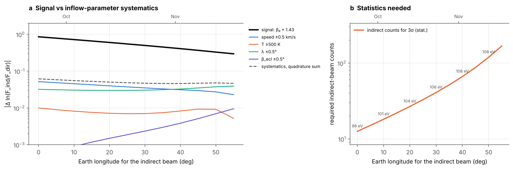

# Interstellar neutral helium beams

**Can the indirect beam of interstellar neutral helium measure its ionization rate independently of the interstellar density?**

A minimal, fully tested hot model of interstellar neutral (ISN) helium at 1 au. It predicts the *direct* and *indirect* ISN He beams that IMAP-Lo can observe, and tests whether their ratio can tell apart the two explanations of the enhanced helium pickup-ion production found with New Horizons/SWAP.

---

## Motivation

Antonik et al. (2025, ApJ 995, 57) derived the ISN He ionization rate from New Horizons/SWAP He⁺ pickup ions. They found it is ≈43% higher than the model based on TIMED solar EUV data scaled with F10.7, in line with the IBEX-Lo analysis of Swaczyna et al. (2022).

Pickup-ion production is proportional to the product *n*_ISN · β. The flux of the ISN He direct beam at IBEX/IMAP-Lo is proportional to *n*_ISN · ε · exp(−β₀⟨X⟩), where ε is the poorly known absolute detection efficiency. Neither observable separates "more ionization" from "more helium" (or from a different ε) on its own. Antonik et al. therefore argued against a time-varying density only indirectly, and pointed to IMAP-Lo's pivot platform, which can observe the indirect beam (Bzowski et al. 2023, ApJS 265, 24), as the decisive test.

This repository quantifies that test for the specific SWAP result.

## The key relation

Helium feels practically no radiation pressure, so ISN He atoms move on Keplerian hyperbolae. Suppose the ionization rate falls off as β(r) = β₀ (1 au / r)². Along a Keplerian orbit the true anomaly changes as dν/dt = h / r², so the exposure has a closed form:

$$\int \beta\,dt \;=\; \beta_0\,\frac{(1\,\mathrm{au})^2\,\Delta\nu}{h} \;\equiv\; \beta_0 X ,$$

where Δν is the angle swept since infinity and h is the specific angular momentum. Two orbits reach each point near the Sun:

- the **direct** orbit, with Δν < 180°;
- the **indirect** orbit, which wraps around the Sun (Δν > 180°) and accumulates two to four times more exposure.

Therefore

$$\ln\frac{F_\mathrm{ind}}{F_\mathrm{dir}} = \mathrm{const} - \beta_0\,\big(\langle X\rangle_\mathrm{ind}-\langle X\rangle_\mathrm{dir}\big),$$

and both *n*_ISN and the absolute efficiency ε cancel.


## Results (model ionization rate β₀ = 1.0×10⁻⁷ s⁻¹ at 1 au)

| Quantity | Value |
|---|---|
| Direct beam, February (Earth at 130°) | mean energy 129 eV, ⟨X⟩ = 0.67×10⁷ s, seen 90° from the Sun (IBEX-Lo geometry) |
| Indirect beam, late October (Earth at 30°) | mean energy 106 eV, ⟨X⟩ = 1.83×10⁷ s, seen ≈59° from the Sun (needs the IMAP-Lo pivot) |
| Response to β₀ × 1.43 (H1) | F_dir × 0.75, F_ind × 0.46, **F_ind/F_dir × 0.61** |
| Response to *n*_ISN × 1.43 (H2) | F_dir × 1.43, F_ind × 1.43, **F_ind/F_dir × 1.00** |
| 10⁴ direct-beam counts plus the matching ≈750 indirect counts | β₀ recovered to about ±2% (1σ); H2 excluded at Δχ² ≈ 220 |
| Inflow-parameter systematics in ln R (±0.5 km/s, ±500 K, ±0.5° in λ and β, quadrature sum) | ≈0.05, compared with a signal of 0.50, so signal/systematics ≈ 10 |

The two beams to compare arrive at similar energies (~106 and ~129 eV). An energy-dependent detection efficiency therefore largely cancels in their ratio, as does the absolute calibration.

The statistical requirement is modest: tens to a few hundred indirect-beam counts, depending on the autumn date. The real limitations are the physics *not* in this model (see [Limitations](#limitations-and-next-steps)).




### All figures

| Figure | Content |
|---|---|
| `fig1_trajectories` | Cold-model sketch of direct and indirect orbits to Earth in October and February |
| `fig2_density_1au` | Validation: ISN He density along Earth's orbit (focusing cone, upwind value) |
| `fig3_skymaps` | Sky maps of both beams with IBEX-Lo and pivoted scan circles |
| `fig4_annual_beams` | Beam fluxes, energies and angle from the Sun over the year |
| `fig5_exposure_response` | ⟨X⟩ of each beam; response of the observables to H1 and H2 |
| `fig6_degeneracy` | (*n*·ε, β₀) constraints: direct beam only vs direct + indirect |
| `fig7_season_systematics` | Signal vs inflow-parameter systematics and required counts vs observing date |
| `fig8_energy_threshold` | Effect of a detector energy threshold on both beams |

PNG and PDF versions are in `figures/`.

## Method

1. **Interstellar gas at infinity.** The gas is a drifting Maxwellian with the IBEX ISN He consensus parameters (McComas et al. 2015): *v* = 25.4 km s⁻¹, λ = 255.7°, β = 5.1°, T = 7500 K, and *n* = 0.015 cm⁻³.
2. **Liouville mapping.** At every point the distribution function is f(**r**, **v**) = f_LISM(**v**_∞) · exp(−β₀X). Here **v**_∞ and X come from an analytic back-trace of the hyperbola (`isnhe/kepler.py`): the eccentricity vector, the true anomaly, and the velocity on the incoming asymptote, ν = −arccos(−1/e).
3. **Moments.** Densities and fluxes are midpoint-rule integrals on a grid of directions × speeds:
   - density: ∫ f d³v in the solar frame;
   - flux: ∫ f v_rel³ dv_rel dΩ for arrival directions in the frame of an observer on a circular 1 au orbit moving at 29.78 km s⁻¹.

   Each grid cell is stored once together with its X and its swept angle (`VelocitySamples`). Rescaling to any β₀ (`exp(−β₀X)`), any density (linear), or any energy threshold is then essentially free.
4. **Observables.**
   - Sky-integrated beam fluxes, flux-weighted energies, beam centroids and widths, and scan circles for a Sun-pointing spinner with an arbitrary boresight (pivot) angle.
   - Poisson counting statistics: the Baker & Cousins (1984) likelihood, as used by Antonik et al. (2025).
   - ⟨X⟩ = −d ln F / dβ₀.

## Validation (`pytest`)

- The back-traced **v**_∞ and exposure agree with a DOP853 numerical integration of the orbit (exposure to <10⁻³; speed at infinity to 10⁻⁷).
- Swept angles and the direct/indirect classification agree with orbits built from orbital elements.
- Far from the Sun (3000 au) the model returns the input density (to 0.3%) and bulk velocity (to 0.1 km s⁻¹).
- Upwind at 1 au, β₀ = 10⁻⁷ s⁻¹ gives *n* = 0.011 cm⁻³. Swaczyna et al. (2025, ApJS 277, 17) adopt ≈0.01 cm⁻³ for solar minimum.
- The direct beam in February is at ≈129 eV in the spacecraft frame, as observed by IBEX-Lo (~130 eV).
- Grid convergence: the production grid (2°, 1 km s⁻¹) agrees with a 4× finer grid to ≲10⁻⁴, and to ~10⁻³ inside the focusing cone (`data/convergence.txt`).

## Repository layout

```
src/isnhe/
    constants.py      physical constants, unit conventions
    lism.py           InflowParams, drifting Maxwellian at infinity
    kepler.py         analytic back-tracing: v_inf, swept angle, exposure X
    hotmodel.py       sky grid, observer state, VelocitySamples, flux and density
    observables.py    annual beam fluxes, <X>, counting statistics, scan circles
scripts/
    compute_annual_beams.py     beam fluxes vs observer longitude x beta0 x energy threshold
    compute_skymaps.py          direct/indirect sky maps
    compute_systematics.py      one-at-a-time inflow-parameter perturbations
    compute_density_profile.py  density along Earth's orbit
    check_convergence.py        grid-convergence table
    run_all.sh                  runs everything (~20 min on 2 cores)
notebooks/figures.ipynb         makes all figures from data/
data/                           outputs of the scripts (.npz, small)
figures/                        PNG + PDF figures
tests/                          pytest suite
```

## Installation and reproduction

```bash
git clone <this repo> && cd isn-helium-beams
python -m venv .venv && source .venv/bin/activate
pip install -e ".[dev]"

pytest                                    # ~15 s
bash scripts/run_all.sh                   # regenerates data/ (~20 min)
jupyter nbconvert --to notebook --execute --inplace notebooks/figures.ipynb
```

Every script accepts `--help`. Inflow parameters and grid resolution can be changed from the command line, for example:

```bash
python scripts/compute_annual_beams.py --temperature 8000 --speed 25.9 --out data/annual_hot.npz
```

## Using the package

```python
from isnhe import InflowParams, flux_samples

p = InflowParams()                 # IBEX consensus inflow, n = 0.015 cm^-3
s = flux_samples(30.0, p)          # observer at ecliptic longitude 30 deg (late Oct)
for beta0 in (1.0e-7, 1.43e-7):
    Fd, Fi = s.total(beta0, "direct"), s.total(beta0, "indirect")
    print(f"beta0={beta0:.2e}  F_dir={Fd:.3e}  F_ind={Fi:.3e}  ratio={Fi/Fd:.4f}")

s.mean(s.energy_eV, 1e-7, "indirect")   # ~106 eV
s.centroid(1e-7, "indirect")            # (lon, lat, rms width) of the beam in deg
s.skymap(1e-7, "indirect")              # cm^-2 s^-1 sr^-1 on a lon/lat grid
```

## Limitations and next steps

This is a one-to-two-day study. The following items are deliberately left out, roughly in order of importance for a real IMAP-Lo analysis:

1. **Secondary helium ("Warm Breeze").** Kubiak et al. (2014) found a slower, warmer secondary He population from a different direction, with its own direct and indirect beams. Its indirect-beam contribution in autumn must be modelled. The code already supports this: compute `flux_samples` for a second `InflowParams` and add the weights.
2. **Time-dependent and non-r⁻² ionization.** Indirect atoms spend months near the Sun, so solar-cycle variation of the photoionization rate matters. Electron-impact ionization falls off faster than r⁻² and is not captured by a single β₀ (Sokół et al. 2019). Both break the closed-form X; a numerical exposure integral along the analytic orbit is the natural upgrade.
3. **Instrument response.** The model uses sky-integrated fluxes, not the IMAP-Lo collimator, pivot schedule, spin-axis offset, energy-dependent sputtering efficiency or duty cycle. The required-counts numbers are statistics only.
4. **Correlated inflow parameters.** The inflow parameters are perturbed one at a time. In practice, speed, direction and temperature from IBEX are correlated and are derived from the same direct-beam data. A joint fit of the inflow parameters and β₀ to both beams is the consistent approach.
5. **Geometry.** IMAP at L1 (0.99 au) and the eccentricity of Earth's orbit are ignored. Radiation pressure and collisional filtration of He are neglected (both are small).

## References

- Antonik, M., Swaczyna, P., McComas, D. J., Elliott, H. A., & Bzowski, M. 2025, ApJ, 995, 57
- Baker, S., & Cousins, R. D. 1984, NIMPR, 221, 437
- Bzowski, M., Kubiak, M. A., Möbius, E., & Schwadron, N. A. 2023, ApJS, 265, 24
- Kubiak, M. A., Bzowski, M., Sokół, J. M., et al. 2014, ApJS, 213, 29
- McComas, D. J., Bzowski, M., Fuselier, S. A., et al. 2015, ApJS, 220, 22
- Sokół, J. M., Bzowski, M., & Tokumaru, M. 2019, ApJ, 872, 57
- Swaczyna, P., Bzowski, M., & Kubiak, M. A. 2025, ApJS, 277, 17
- Swaczyna, P., Kubiak, M. A., Bzowski, M., et al. 2022, ApJS, 259, 42

## License

MIT, see `LICENSE`.
