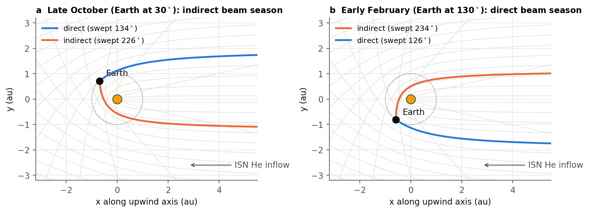
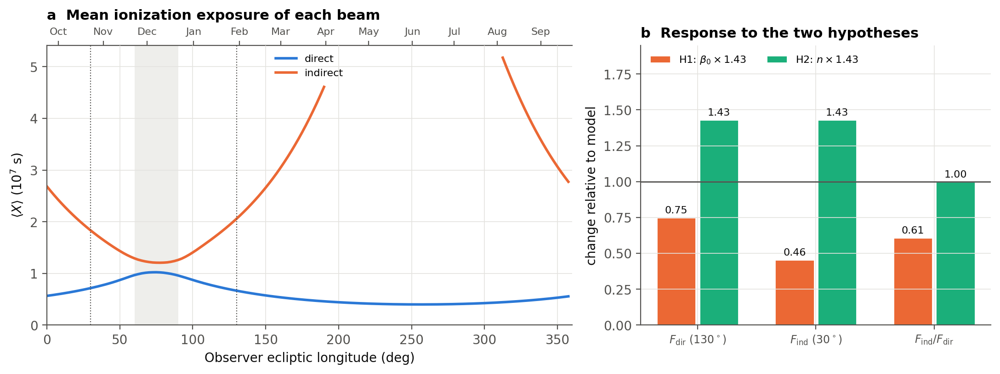
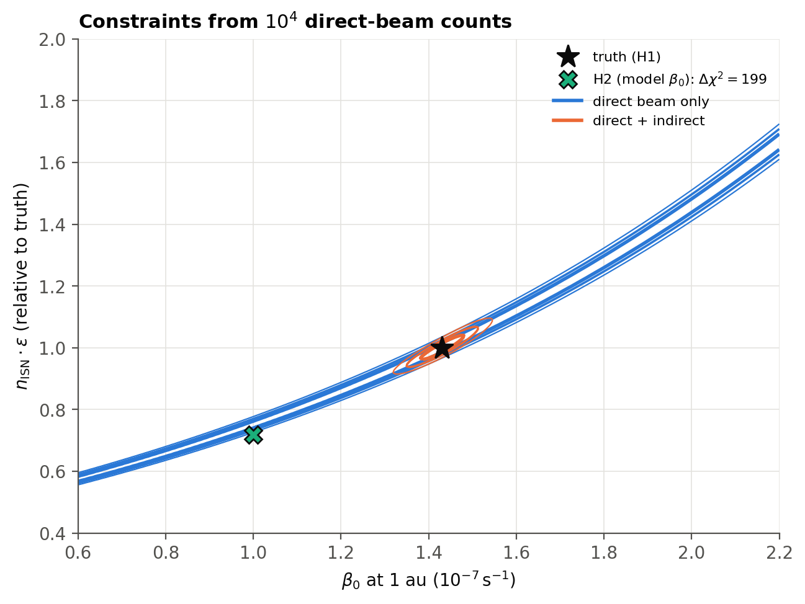

# Interstellar neutral helium beams

A small side project: an analytic hot model of interstellar neutral (ISN) helium at 1 au. It looks at whether the ratio of the indirect to the direct beam (as IMAP-Lo could see it) can tell a higher He ionization rate apart from a higher interstellar He density.

Motivation: New Horizons/SWAP pickup ions suggest the He ionization rate is ~43% higher than models (Antonik et al. 2025). But pickup ions and the direct-beam flux both scale with density × survival, so they can't separate the two on their own. Bzowski et al. (2023) proposed comparing the direct and indirect beams instead, and this repo is my attempt at a quick implementation of that idea.

For more details on the physics and the figures, see the [report (PDF)](report/report.pdf).

## Idea

Atoms move on Keplerian hyperbolae under solar gravity (radiation pressure is ignored for now). Two orbits reach every point near the Sun:

- the **direct** orbit, which sweeps less than 180° from infinity
- the **indirect** orbit, which wraps around the Sun first (Δν > 180°)

If the ionization rate falls off as β(r) = β₀ (1 au / r)², then since dν/dt = h / r² along the orbit, the exposure has a closed form:

$$\int \beta\, dt = \beta_0 \frac{(1\,\mathrm{au})^2 \Delta\nu}{h} \equiv \beta_0 X$$

where Δν is the angle swept since infinity and h is the angular momentum. Indirect atoms end up with 2–4× more exposure than direct ones, so

$$\ln\frac{F_\mathrm{ind}}{F_\mathrm{dir}} = \mathrm{const} - \beta_0\,\big(\langle X\rangle_\mathrm{ind}-\langle X\rangle_\mathrm{dir}\big)$$

The density cancels in the ratio, and so does the absolute detector efficiency (as long as it's the same for both beams, which it isn't quite, since the beams arrive at different energies). The closed form is checked against numerical orbit integration in the tests.



## How the model works

- The gas far away is a drifting Maxwellian with the IBEX consensus parameters (McComas et al. 2015): v = 25.4 km/s, λ = 255.7°, β = 5.1°, T = 7500 K, n = 0.015 cm⁻³.
- At any point near the Sun the distribution function comes from Liouville's theorem, f(r, v) = f_LISM(v∞) exp(−β₀ X), where v∞ and X come from tracing the hyperbola back to infinity analytically (`src/isnhe/kepler.py`).
- Densities and fluxes are integrals over a grid of directions × speeds. Fluxes are in the frame of an observer on a circular 1 au orbit (moving at 29.78 km/s).
- Each grid cell stores its X, so changing β₀, the density or an energy threshold doesn't need a recompute.
- The mean exposure of a beam is ⟨X⟩ = −d ln F / dβ₀.

## Some results

With β₀ = 1×10⁻⁷ s⁻¹, direct beam in February (Earth at 130°) and indirect beam in late October (Earth at 30°):

- direct beam: ~129 eV, ⟨X⟩ ≈ 0.67×10⁷ s
- indirect beam: ~106 eV, ⟨X⟩ ≈ 1.83×10⁷ s, ~59° from the Sun (needs the IMAP-Lo pivot)
- H1, β₀ × 1.43: F_dir × 0.75, F_ind × 0.46, so F_ind/F_dir × 0.61
- H2, n × 1.43: both fluxes × 1.43, so F_ind/F_dir unchanged

So a 43% higher ionization rate drops the ratio by ~40%, while more helium doesn't change it at all. One catch is that the two beams arrive ~20% apart in energy (129 vs 106 eV), so an energy-dependent efficiency won't fully cancel. Bzowski et al. (2023) suggest picking direct/indirect pairs at matched energies instead.




### Figures

PNG and PDF versions are in `figures/`. Full descriptions are in the [report](report/report.pdf).

1. **Trajectories:** cold-gas (T = 0) sketch of the direct and indirect orbits that hit Earth in October and February.
2. **Density at 1 au:** He density along Earth's orbit for a few β₀ values, split into direct and indirect atoms. A sanity check: the upwind value is ~0.011 cm⁻³ (Swaczyna et al. 2025 use ~0.01), and the downwind peak is the gravitational focusing cone.
3. **Sky maps:** where the two beams show up on the sky in October and February, with the IBEX-Lo 90° scan circle and the pivot angle needed to hit the indirect beam. In February the indirect beam comes from too close to the Sun to see.
4. **Over the year:** beam fluxes, mean energies and angle from the Sun vs Earth's longitude. Grey bands mark where the two beams overlap.
5. **Exposure and response:** ⟨X⟩ for each beam, and how F_dir, F_ind and their ratio respond to H1 and H2.
6. **Degeneracy:** fit of (n·ε, β₀) to noise-free fake data from H1. The direct beam alone gives a degenerate band; adding the indirect beam closes the contour.

## Not included (yet)

- radiation pressure: changes the indirect-beam flux by up to ~9% (Kowalska-Leszczyńska et al. 2023), and it breaks the closed form for X
- other near-Sun losses (e.g. elastic scattering by the solar wind): these would lower the ratio just like a higher β₀ does
- secondary He (the "Warm Breeze"), which has its own direct and indirect beams
- time-dependent and non-r⁻² ionization (e.g. electron impact). The two beams are observed months apart, so this matters.
- instrument response (collimator, pivot schedule, efficiency vs energy)
- systematics from the inflow parameters and the required counting statistics

## Report

A longer write-up of the physics and the figures is in [report/report.pdf](report/report.pdf) (source: `report/report.tex`, build with `bash report/run.sh`).

## Running it

```bash
pip install -e ".[dev]"
pytest
bash scripts/run_all.sh        # makes data/
jupyter nbconvert --to notebook --execute --inplace notebooks/plot_figures.ipynb
```

The code is explained, with the physics behind each part, in [src/README.md](src/README.md) (the model) and [scripts/README.md](scripts/README.md) (the data-generation scripts).

Quick example:

```python
from isnhe import InflowParams, flux_samples

p = InflowParams()
s = flux_samples(30.0, p)      # Earth at 30 deg (late October)
for beta0 in (1.0e-7, 1.43e-7):
    Fd, Fi = s.total(beta0, "direct"), s.total(beta0, "indirect")
    print(beta0, Fd, Fi, Fi / Fd)
```

## References

- Antonik, M., et al. 2025, ApJ, 995, 57
- Bzowski, M., Kubiak, M. A., Möbius, E., & Schwadron, N. A. 2023, ApJS, 265, 24
- Kowalska-Leszczyńska, I., Kubiak, M. A., & Bzowski, M. 2023, ApJ, 950, 98
- Kubiak, M. A., Bzowski, M., et al. 2023, arXiv:2309.06931
- McComas, D. J., et al. 2015, ApJS, 220, 22
- Swaczyna, P., et al. 2022, ApJS, 259, 42
- Swaczyna, P., Bzowski, M., & Kubiak, M. A. 2025, ApJS, 277, 17

## License

MIT
